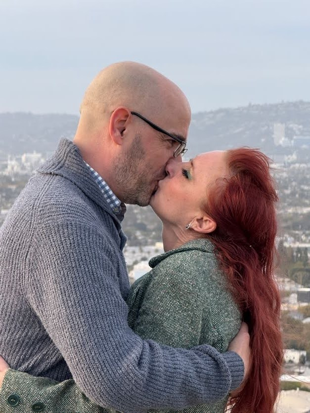
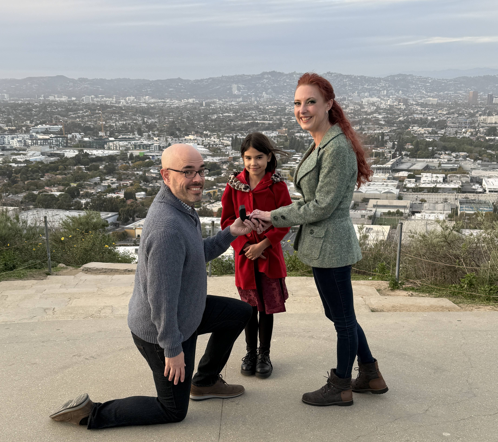
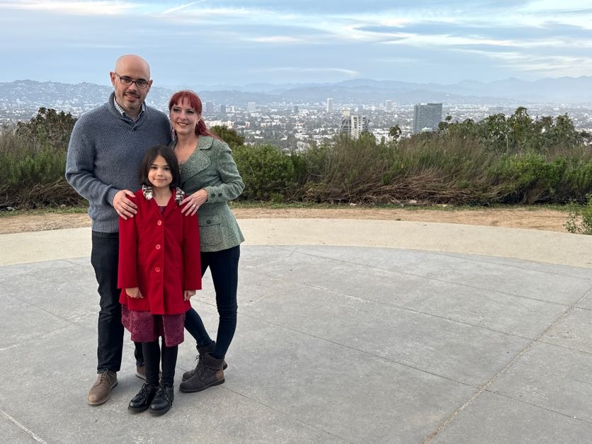

## 💍 She Knew. He Kneeled. Fiona Approved.

Baldwin Hills Scenic Overlook wasn’t just a pretty backdrop. 🌄 It was the place where, early in their story, Sean realized something quietly enormous: he didn’t just want to keep talking to Emily—he wanted to kiss her. 😘 Later, when she came back to LA as his girlfriend, they returned to that same spot and kissed properly, with all the clarity that comes from being on the same page.

> 

So when they planned to take some family photos there with Fiona, Emily already had a hunch. The box, the setting, the timing—it all lined up. 🗃️🕰️ Sean, to his credit, still gave it his all: one knee, one ring, and one very proud kid standing between them, grinning like the mastermind she is. 👧🏽💍🦊

> 

Fiona was the only one truly surprised—which is poetic, considering she tried to make them hold hands the very first day they met. 🫱🏼‍🫲🏽❤️

> 

No flash mobs. No skywriting. Just a quiet, perfect moment in a place that already meant everything, shared by the people who made it unforgettable. ✨
